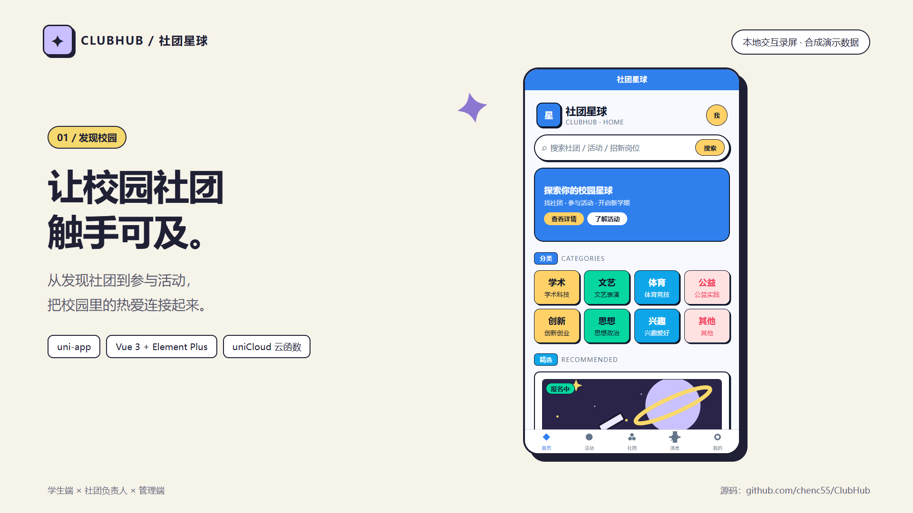
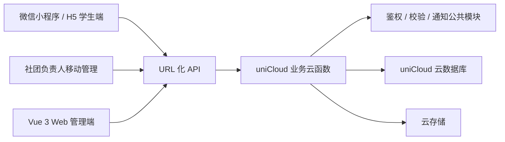

# 社团星球 · ClubHub

面向单所高校的校园社团服务平台，连接学生、社团负责人和平台管理员，覆盖社团发现、活动报名、招新与运营审核。

**技术栈：uni-app / Vue 3 / Pinia / Element Plus / uniCloud JavaScript 云函数 / 云数据库。**

[观看 60 秒演示](docs/media/clubhub-demo-60s.mp4) · [本地运行](docs/RUNNING.md) · [验证记录](docs/VALIDATION.md)

安全状态见[安全复核记录](docs/SECURITY-REVIEW.md)。本次依赖修复后，三个锁文件的 npm 审计均为 0 告警；升级及回归范围见[依赖修复记录](docs/DEPENDENCY-REMEDIATION.md)。仓库用于源码和本地演示展示，云端及真机验收仍需独立完成。



## 功能与角色

| 角色 | 主要功能 |
| --- | --- |
| 学生 | 浏览社团与活动、学号认证、活动报名与候补、签到、招新报名、消息中心、个人资料与注销申请 |
| 社团负责人 | 社团资料、活动发布与报名名单、签到管理、招新表单与筛选录取、成员管理、社团统计 |
| 平台管理员 | 白名单导入、社团/活动/招新/申诉审核、内容监管、公告、账号权限、运营数据统计 |

移动入口使用 uni-app，面向微信小程序与 H5；Web 管理端使用 Vue 3 与 Element Plus。范围限定为单校场景，不包含支付、多校 SaaS、点赞评论或校方统一身份认证。

## 实现重点

- **活动报名闭环**：活动状态、审核报名与候补递补分支，以及报名名单与签到结果。
- **招新流程**：单选、多选、文本字段组成报名表，支持面试、录取及成员关系维护。
- **权限与隐私**：管理员角色守卫、云函数授权检查、负责人侧学号脱敏、注销申请及关联记录审计。
- **业务分域**：13 个云函数业务域与共享鉴权、校验、通知模块；集合与状态机以需求文档为基线。
- **可验证交付**：保留离线验收脚本；演示录制包含页面操作及接口返回断言。



## 快速体验

需要 Node.js 20+。在仓库根目录执行：

```bash
npm ci --prefix admin
npm ci --prefix uniapp
npm run demo
```

- 学生端：<http://127.0.0.1:5173>，在登录页点击「开发测试登录」。
- 管理端：<http://127.0.0.1:5174>，演示账号 `demo`，密码 `DemoOnly@2026`，验证码 `DEMO`。
- 演示接口只监听 `127.0.0.1:4175`，数据在内存中，重启即恢复样例。

**本地演示使用合成数据适配器，不连接原开发云空间。** 适配器仅覆盖视频所需的页面与交互，未覆盖的接口明确返回错误；完整业务后端位于 `uniapp/uniCloud-aliyun/cloudfunctions/`。

## 演示视频

视频为 1920 × 1080、60 秒实际浏览器录屏，配有中文画面说明，无旁白。

| 时间 | 内容 |
| --- | --- |
| 00–07 秒 | 首页与活动发现 |
| 07–23 秒 | 查看活动、填写备注、提交报名 |
| 23–29 秒 | 查看报名结果 |
| 29–36 秒 | 招新动态表单交互 |
| 36–51 秒 | 管理工作台、活动审核确认及列表更新 |
| 51–60 秒 | 四维统计与项目入口 |

视频中的人数、姓名、社团、活动及统计数值均为合成演示样例，不代表真实运营规模。微信登录、订阅消息、真机扫码与定位能力未在本视频中验收。

## 目录

```text
admin/                  Vue 3 + Element Plus 管理端
uniapp/src/             uni-app 学生与负责人页面
uniapp/uniCloud-aliyun/  业务云函数、公共模块、数据库 schema 与索引
uniapp/scripts/         离线验收与公共模块同步脚本
demo/                   本地合成数据适配器、启动与录屏脚本
docs/                   运行说明、验证记录与视频
功能需求.md              需求、集合字段与状态机基线
design.md               界面设计规范
```

## 验证与边界

本次交付通过 37 个离线测试脚本、管理端构建与 H5 构建。浏览器验收覆盖视频中的登录、报名、招新字段交互、审核及数据展示，详见[验证记录](docs/VALIDATION.md)。

本仓库为求职展示整理版：原云空间地址、微信 AppID、原管理员种子凭据与白名单种子未发布；云端接入需要配置自己的服务空间。未进行新的线上部署、真实运营试运行或生产并发验收。
